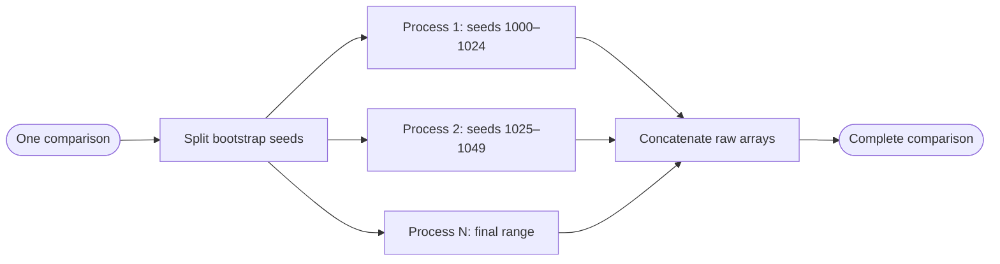

# CUDA backend

Use the same `brainmodel_utils` consistency interface on an NVIDIA GPU. The CPU interface and default behavior are unchanged.

## 📦 Installation

The packaged GPU extra supports CUDA 12:

```bash
python -m pip install -e ".[cuda12]"
```

This installs `cupy-cuda12x` and PyTorch. The PyTorch build must include CUDA support. For another CUDA major version, install its matching CuPy wheel and a compatible CUDA-enabled PyTorch build, then install `brainmodel_utils` without the `cuda12` extra.

Check both dependencies before a long run:

```python
from brainmodel_utils.neural_mappers.backends import (
    cuda_available,
    torch_cuda_available,
)

assert cuda_available(), "CuPy cannot access a CUDA device"
assert torch_cuda_available(), "PyTorch cannot access a CUDA device"
```

## 🚀 Usage

Add `backend="cuda"` to the mapper settings and use `num_parallel_jobs=1`. Float64 inputs are recommended for scientific results.

```python
import numpy as np

from brainmodel_utils.metrics.consistency import get_linregress_consistency

rng = np.random.default_rng(0)
source = rng.standard_normal((40, 64)).astype(np.float64)
target = rng.standard_normal((12, 40, 32)).astype(np.float64)

map_kwargs = {
    "map_type": "percentile",
    "map_kwargs": {
        "percentile": 95,
        "identity": False,
        "regression_type": "Ridge",
        "regression_kwargs": {"alpha": 1.0},
        "backend": "cuda",
    },
}

results = get_linregress_consistency(
    source=source,
    target=target,
    map_kwargs=map_kwargs,
    num_bootstrap_iters=10,
    num_parallel_jobs=1,
    start_seed=42,
    metric="pearsonr",
)

print(results["test"]["r_xy_n_sb"].shape)
```

For direct multi-target Ridge without percentile selection, change the mapper configuration:

```python
map_kwargs = {
    "map_type": "sklinear",
    "map_kwargs": {
        "regression_type": "Ridge",
        "regression_kwargs": {"alpha": 1.0},
        "backend": "cuda",
    },
}
```

## ⚙️ Supported settings

| Setting | CUDA behavior |
| --- | --- |
| `backend` | Must be `"cuda"`; `"cpu"` remains the default elsewhere |
| `regression_type` | `"Ridge"` only |
| `alpha` | Finite, positive scalar |
| `fit_intercept` | Boolean |
| `solver` | Omit or use `"auto"` |
| `percentile` | Supports percentile source selection, including percentile 0 |
| `identity` | May be `True` only at percentile 100; use `False` for learned Ridge |
| Input dtype | Float32 or float64; float64 is the validated recommendation |
| `num_parallel_jobs` | Must be `1` inside each CUDA consistency process |

Unsupported options, an invalid backend, or an unavailable CUDA dependency raise an error.

## 🧠 Precision and memory

By default, the input arrays determine the compute precision. Convert both arrays explicitly when precision matters:

```python
source = np.asarray(source, dtype=np.float64)
target = np.asarray(target, dtype=np.float64)
```

Float64 CPU and CUDA results are very close in terms of error. The sampled float32 cases do not support treating float32 as interchangeable with float64, particularly at high regularization strengths. See the [benchmark report](BENCHMARKS.md) for measured errors and workload details.

For a large percentile fit, `store_correlations=False` avoids retaining the full source-by-target correlation matrix after selection. Users can tune `correlation_target_batch_size`, `ridge_workspace_bytes`, and `ridge_max_batch_size`, but their best values depend on the percentile, GPU, and number of concurrent processes. Start with the defaults and measure the complete workload before increasing batch sizes.

## 🧵 Bootstrap sharding

`num_parallel_jobs` controls joblib workers inside one call. CPU calls can use it to divide bootstrap iterations, but CUDA calls require `num_parallel_jobs=1`.

To reduce the latency of one CUDA comparison, run several external CUDA processes with non-overlapping bootstrap seed ranges. Every process still uses `num_parallel_jobs=1`.



For example, eight processes can split 200 bootstraps into eight 25-bootstrap shards:

| Shard | `start_seed` | `num_bootstrap_iters` | `num_parallel_jobs` |
| ---: | ---: | ---: | ---: |
| 1 | 1000 | 25 | 1 |
| 2 | 1025 | 25 | 1 |
| … | … | … | 1 |
| 8 | 1175 | 25 | 1 |

Sort completed shards by `start_seed`, verify that their seed ranges are contiguous and their settings and non-bootstrap dimensions match, then concatenate every raw `train` and `test` metric array along axis 0. Do not average shard summaries. Saving each shard separately also makes the outer campaign restartable.

Independent comparisons use the same process-level pattern for throughput, without merging their outputs. Processes may share one GPU when memory permits or be assigned to different GPUs. Device and host memory grow with process count, so choose the process count from a short screen on the target workload.

Sharding and multi-GPU device assignment were validated by the benchmark campaign, but they are usage examples rather than `brainmodel_utils` helpers. Native distributed Ridge and splitting one fit across several GPUs is a similar process to sharding on one GPU. You could also split up the targets or source as well in a similar manner.

## 📊 Results

The [CUDA benchmark report](BENCHMARKS.md) contains the frozen CPU/CUDA correctness checks, real-data timings, memory measurements, and validation limits.
